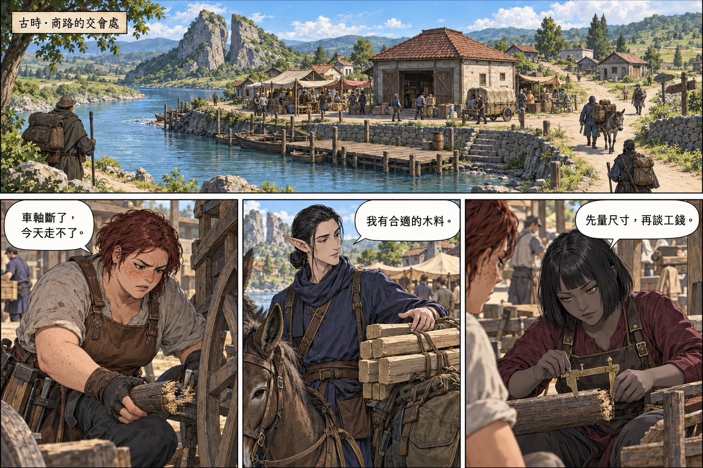
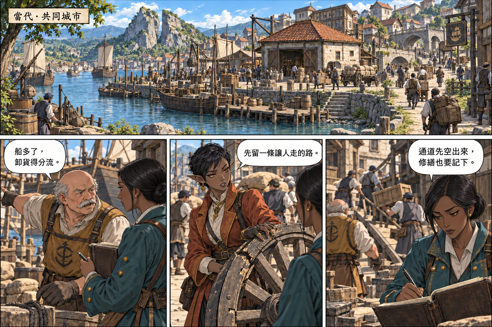

# 劇情重整與漫畫樣頁交付

2026-10-10。本機程式 v0.85.95，敘事內容版 0.6.0；正式漫畫目錄仍是 1.0.0 的 12 頁。這次完成第一主線弧的 44 頁文字分鏡與兩張古今彩色樣頁，不是 44 張已完成漫畫，也不是 GitHub 更新。

## 這次修改了什麼

- [前導第 1 至 12 頁](STORY_SCREENPLAY_V2_PROLOGUE.md)：各自家園、赴市、受雇合作、結算返鄉、多次往返、多方協商擴建，最後切入同址當代城市。
- [主線第 13 至 44 頁](STORY_SCREENPLAY_V2_MAIN_ARC.md)：王子處理公務及家人互動、英雄身分、遇害與救援、線索和傳言、依法查案受阻、撤權護證、銀葉開戰、維菈解禁的代價及階段成果。每頁四格，共 176 格。
- 作者確認公共會所附屬閱覽室案發、屏風焦紋形成時間不符、可追查交接遭拒後雷恩護證而被追捕；不藉此確認凶殺手法、全部對白或禁術技術細節。
- 雷恩是禁衛軍團長、希爾芙是銀葉公主、維菈是暮影現任領導者，均沿用遊戲英雄原圖。暮影前代缺失原因仍保留未知。
- 三個 AI 角色交叉審查世界觀、因果和外觀，修正希爾芙目擊範圍、維菈研究與施術銜接、老王恐懼到誤判的過程。不是人類专家背書。

## 古今樣頁

樣頁從同一河灣、裂口岩體與紅瓦貨棧建立視覺連續；當代增加街區、公共設施和貨運規模，沒有王國旗海或宮殿統治天際線。古代人物仍是普通商旅，不是英雄換素衣。





當代調度員初稿太像古代紅髮女工，已將三格統一改為黑髮、深褐膚色、無雀斑的另一名女性。原稿及生成原檔保留，修正版不覆寫原件。這兩頁只驗證場景與配角方向，不頂替前導的全部事件。

待作者視覺驗收：遮住年代文字，能否看出同一地點的古今差異；是否仍誤以為配角是同一人；當代是否像成熟共同城市，而不是王國首都。AI 已目視複核，未宣稱使用者盲測或手機閱讀驗收已完成。

## 本機遊戲修正

`StoryCatalog.js` 修正兩處「蘭恩」為「雷恩」、五波實戰被稱為新兵演練的矛盾，以及雷恩彷彿首次得知親衛命令體系存在的表述。改為核對具體命令來源與行動，不把片段紀錄當定罪結論。

不改關卡 ID、順序、地圖、波次組成、獎勵、解鎖或存檔鍵。新版漫畫尚未替换正式目錄，遊戲仍顯示原 12 頁；其餘舊主線銜接不能宣稱已全面修好。

## 架構與維護

```text
作者確認 → WORLD_STORY_REVISION_V2
                     ↓
前導 12 頁 + 主線 32 頁 → 交叉審稿 → 彩色樣頁 → 作者視覺驗收
                                                       ↓ 尚未放行
                                                正式逐頁繪製與核對
                                                       ↓
                                     WebP + StoryMangaCatalog + 文字與情緒配樂
                                                       ↓
                                         橫式閱讀測試 → 發布核准
```

本輪不新增資料庫、API、套件或網路服務。分鏡放在 docs，樣頁與完整生成／修圖提示詞放在 `assets/td/concepts/story-comic-v2/production-review.json`；使用內建 imagegen 生成。發布工具原有 `assets/td/concepts/` 排除規則繼續生效。測試不可把「檔案存在」當成美術合格。

## 安裝操作與測試

安裝與啟動沿用 [安裝手冊](INSTALLATION.md)，不需額外設定；玩家繼續從劇情模式進入橫向漫畫閱讀器。文字稿由維護者在 docs 閱讀，樣頁不加到普通玩家選單，也不改通關權限。

從專案根目錄執行：

```powershell
node --test tests/td-story-editorial-v2.test.js tests/td-story-manga.test.js tests/td-profiles-story.test.js tests/static-site-package.test.js
npm test
```

新增五項測試：逐一比對修正前後關卡遊戲資料、檢查人名／敘事措辭、排除未核准圖稿、44 頁連號及每頁四格、遊戲版本與敘事版本分離。測試使用本輪修改前的 StoryCatalog 快照，不回退其他既有修改。

2026-10-10 實測：新增五項測試通過，全套 `node --test --test-reporter=dot tests/*.test.js` 結束碼為 0；StoryCatalog 與 service worker 語法檢查通過。首次全套測試抓到 td.html 版本標記漏改與舊文案斷言，修正後重跑通過。`git diff --check` 無空白錯誤，僅現有 LF／CRLF 提示。這不等於全篇漫畫、美術主觀品質或真機閱讀驗收。

## 部署與回復

本輪未 commit、push 或部署。未來需另經發布授權並依 [部署手冊](DEPLOYMENT.md) 驗證 GitHub Pages 產物與線上版本，不能只看到推送成功就稱更新完成。發布包不含概念稿、此逐頁劇本或修改前快照。

本輪修改前的劇情檔保存在 `assets/td/concepts/story-comic-v2/StoryCatalog-before-0.85.95.js`。需要回復時先備份當下工作區，逐段比對此快照與目前 StoryCatalog，只還原本輪文字變更；不要直接覆蓋後續修改，不要 reset 整個工作區。版本標記位於 package.json、sw.js、td.html、update.html、ProfileStore、FrontierApp、BattleReportSystem，回復時保持一致。沒有存檔遷移，不需刪除玩家資料。已發布版本的回復必須建立新的快取版本，不重用舊快取代號。

## 還需要繼續的部分

1. 作者驗收古今樣頁；受害方式、撤離路線及禁術細節仍需在繪製相關場景前定稿。
2. 依 44 頁分鏡逐批繪製，每頁英雄都附遊戲原版參考；同名不換臉，重要人物首度出現帶身分框。
3. 每批完成後核對五官、事件先後、對白、縮小閱讀及配樂，再替換正式目錄。不能一次把未驗收圖全部塞入遊戲。
4. 第一主線弧完成後再重排西行、霜原、地精與潮衛篇，讓每段有實際成果；這次沒有擅自揭露所有異常同源或古代謎團答案。

目前不能宣稱全劇情完成、44 頁已畫完、所有舊圖已替換、手機已實測新版樣頁或 GitHub 已更新。
